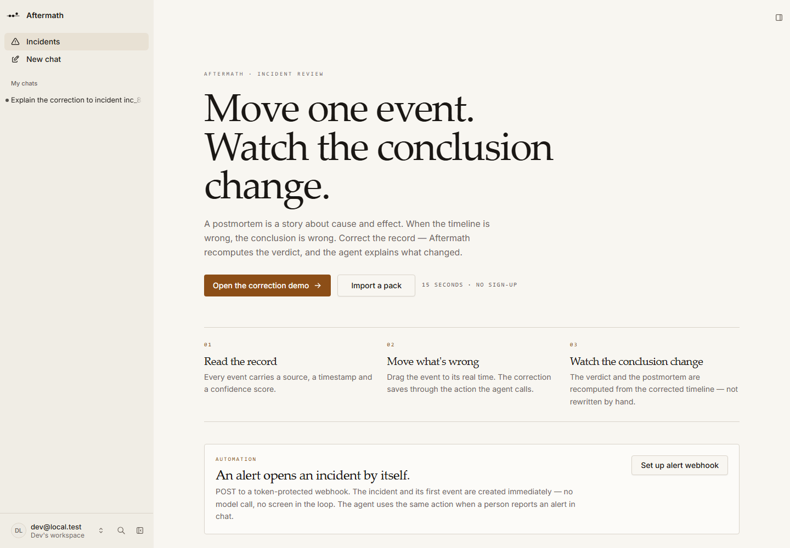

# Aftermath

**An incident postmortem where the timeline is editable and the conclusion is recomputed.**

Built for the [Agent-Native Hackathon](https://www.builder.io/hackathon) on Builder.io's open-source [Agent-Native](https://agent-native.com) framework.

## Live demo

**https://aftermath-live.vercel.app**

No login is required. The production deployment issues a demo identity through the auth layer (`getAdditionalSession` gated by `AFTERMATH_PUBLIC_DEMO=1`), so reviewers open the URL and land in the app. Destructive actions (`delete-incident`, `delete-incident-event`, `delete-incident-comment`) and webhook token rotation are closed in public-demo mode; everything the demo needs stays open.

The demo data is fictional. Use the **Import a pack** screen or re-run `seed-demo-incident` if the timeline has been changed. If the flag is turned off, the same deployment falls back to normal sign-in; the account `demo@aftermath.app` / `Aftermath-demo-2026` exists for that case. The read-only postmortem for the seeded incident is also public:

**https://aftermath-live.vercel.app/share/03UOScRIovmxePovSGf__I3S**

Deployment runs on Vercel with hosted Neon Postgres, release migrations applied. Sign-in is enabled; the demo account is the shortcut for reviewers.



---

## The problem

A postmortem is a story about cause and effect: *the deploy at 14:02 caused the errors at 14:03.* If the deploy actually happened at 14:12, that story is false — and every conclusion built on it is false too.

Timelines are usually wrong in small ways. Someone rebuilds them by hand from logs, deploys, alerts and chat, and the postmortem records whatever the room agreed on. Correcting the record later means rewriting the document by hand, and nobody does.

## The 90-second demo

1. **Read the original story.** The r-482 deploy is at **13:40**, but the incident channel says it was promoted at **14:02**. Onset is **14:05**. The database failover at 14:00 leads at **5 minutes**; exposure is **43 minutes**.
2. **Correct it.** One click (*Try the correction*) moves the deploy to the promotion time, **14:02**.
3. **Watch the conclusion change.** The deploy now leads at **3 minutes**; exposure drops to **21 minutes**. The database failover becomes **outcompeted and contradicted** by the flat DB connection-error metric, and the conflict card offers one-click resolutions for both disputed times.
4. **The postmortem updates itself.** The generated document includes the metrics, the candidate causes, and a **correction log**:

   > “r-482 deploy”: originally 13:40 UTC, corrected to 14:02 UTC.

That last line is the point. Most tools let you edit a timeline. Aftermath makes the correction part of the record, and recomputes what the record means.

## Bring your own incident

Open **Import a pack** (`/incidents/new`), paste what you actually have — alerts, deploys, log lines, chat, one event per line — or open a `.txt`, `.csv`, `.log`, `.md`, `.vtt` or `.srt` file — and press **Build timeline**. Times and sources are kept exactly as written; WebVTT and SRT cues become chat events at their cue time; lines without a time are skipped, not guessed. Or hand the same pack to the agent: it calls `create-incident-from-pack` and builds the same timeline through the same action.

```text
14:03 [error] 5xx rate climbs from 0.2% to 8.4% | Grafana
14:02 [deploy] checkout v2.14.3 to production | GitHub Actions #4821
14:12 [log] database connection pool saturated (100/100) | RDS metrics
```

Then challenge it. **Challenge this correction** runs `challenge-incident`: what the new time contradicts, which nearby signal now coincides, which claims are unverified, and the one question that would settle it. The agent can answer that question using the same timeline.

## The timeline is a real editor

Drag any event to correct its time. While dragging, the label shows the exact minute and a ghost marker holds the original position. Arrow keys move the focused event one minute; **Shift + arrows** move five. Zoom with **⌘/Ctrl + scroll**, pan with **Shift + scroll** or by dragging empty canvas, and undo/redo with **⌘/Ctrl + Z**. Low-confidence events are drawn with dashed labels, and the paperclip badge opens the evidence that supports the event — source, link and excerpt — without leaving the timeline.

## Where the two stories disagree

`list-conflicts` returns the unresolved disagreements as question cards: the record versus the channel, or the suspect versus the metric that contradicts it. Each card carries both events with time and confidence, and resolutions are exact `update-incident-event` patches. The **Accept the evidence** option marks the disputed event as a red herring, which removes it from the candidate causes and reruns the analysis. The agent gets the same cards and the same patches; it cannot resolve a question by prose alone.

## Automation

The incidents page installs a **token-protected alert webhook**. POST an alert and the incident, plus its first event, are created immediately — no model call and no screen in the loop:

```bash
curl -X POST http://localhost:8080/api/ingest-alert \
  -H "content-type: application/json" \
  -H "x-aftermath-token: <token from Set up alert webhook>" \
  -d '{"title":"p95 latency above 2s","severity":"sev2"}'
```

The same operation is the `create-incident-from-alert` action, so the agent can call it when a person reports an alert in chat. A wrong token returns **401**; the alert source is kept as the incident's first timeline event.

## Generative UI and the incident team

Four actions declare a native chat card: `analyze-incident` shows the verdict, the four metrics and the leading theory; `simulate-rollback` renders a slider that recomputes exposure from the real window; `list-conflicts` renders the two-sided conflict cards with resolutions; `challenge-incident` renders the objections and the settling question. The cards are registered once in `app/components/chat/aftermath-cards.tsx`; the renderer reads the full action result rather than a projected summary, so the card and the page cannot disagree.

For a multi-step review the agent can spawn framework agent teams. The `.agents/skills/incident-team/SKILL.md` roles are Log Analyst, Pattern Analyst, Comms Writer and Remediation Engineer. Every role calls the deterministic actions, every number comes from an action result, and the parent attributes each role's output. Sub-agents cannot approve or ship.

## Recurrence memory and detection gap

`find-similar-incidents` compares the open incident with seeded past postmortems and returns the closest failure mode with its shared keywords. There are no embeddings in this build, so the method is explicitly labelled a keyword fallback — never presented as semantic search.

`detection-gap` compares the earliest sustained failure with the page time and proposes a concrete metric, threshold and duration. The demo incident's gap is one minute; the suggestion becomes an action item rather than a vague "improve monitoring".

## Share and export

- **Share** copies a public, read-only postmortem link (`/share/<token>`). The page renders without a session: same document, no app chrome.
- **Print** opens the browser's print dialog with a print stylesheet that strips the comparison, timeline, sidebars and buttons — leaving the postmortem for **Save as PDF**.
- **Slack** copies a formatted update with the verdict, the minute delta, the impact window, the corrections and the public link.
- **Discussion** comments are part of the incident and the generated document, so a decision recorded during the incident survives in the postmortem.
- **Search and filters** narrow the incident list by text, severity and status; the filter state lives in the URL, so it is shareable and visible to the agent.

## Review & ship

Approval is a checklist, not a button. `get-readiness` verifies the impact window, the marked cause, owner teams, a detection item, a prevention item, blame-free language, and that no competing theory is still plausible. `lint-blame` lists any individual-blaming sentence with a systemic rewrite.

`get-summaries` renders the same computed facts for engineers, executives and customers. Approving creates seven artifacts from the incident: three Linear issues for the action items, a GitHub draft PR for the prevention work, a Slack post, a Statuspage draft and a Notion export. Until provider credentials are connected these are stored as **fixture** artifacts and labelled `fixture` in the UI; nothing claims to be live.

## Connections

`/connections` lists the evidence providers with an **evidence-coverage meter** across deploy, database, DNS/CDN, monitoring and comms. Each card states **Connected (live)**, **Connected (fixture)** or **Not connected**; nothing fixture-backed is presented as live.

Connect verifies the connection, Test records a delivery, and Send test event appends one provider-shaped event to the open incident. Every adapter normalizes to the same timeline event kinds, so adding a provider does not touch the analysis engine.

No live provider credentials are connected in this build. The provider calls are fixture-backed and labelled. Real GitHub, Vercel, Slack, Linear, PagerDuty, Sentry, Supabase and Cloudflare credentials would switch the same cards to `Connected (live)`.

## Model

The runtime engine is pinned in `server/plugins/agent-native-email-branding.ts` via `defineAppConfig({ agent: { engine: "ai-sdk:openrouter", model: "nvidia/nemotron-3-ultra-550b-a55b:free" } })`, mirrored in `agent-native.config.ts` for the build/client. The live deployment holds `OPENROUTER_API_KEY` as a Vercel secret, so the agent is available to every visitor without a connect step. The free OpenRouter catalog has no reliable non-reasoning tool model that also answers incident questions correctly; Ultra is the fastest one that does (tool call in ~4s), and it can answer with reasoning disabled at the API level. Locally, put the same key in `.env.local` (git-ignored) or connect Builder.io in the app.

## Why this is agent-native

- **One action, every surface.** `analyze-incident` is a typed function. The page calls it through a React hook, the agent calls it as a tool, and it is reachable over HTTP and the CLI. There is no second implementation of the verdict.
- **Original times are stored, not overwritten.** `incident_events.original_at` keeps the first version of every event, so “before” and “after” are both true data, not UI state.
- **The agent narrates; it does not invent.** The verdict, minute delta, impact window and nearest signal are computed. The model is instructed to explain them and never fabricate events, sources or confidence scores.
- **The agent builds the timeline too.** `create-incident-from-pack` and `add-incident-event` are actions, so the import screen and the agent create the same rows. Pasting a pack into chat is a supported path, not a demo trick.
- **It argues with you.** `challenge-incident` returns evidence-based objections and the question that would settle the dispute. The agent answers from the timeline, not from vibes.
- **Owner-only approval.** `approve-postmortem` is `uiOnly`: it works for a signed-in person in the app and is refused for the agent, MCP, raw HTTP and the CLI. Verified:

  ```
  $ pnpm action approve-postmortem --id inc_…
  Action "approve-postmortem" failed: This action can only be called from the signed-in app UI.
  ```
- **Shared application state.** The selected event is published to `selection` state, so “move this one” resolves without the user naming it.
- **Four-area parity.** Every feature has a UI, an action, written instructions (`AGENTS.md`) and application state.

## Actions

| Action | What it does |
| --- | --- |
| `list-incidents` | Incidents, newest first; optional text, severity and status filters |
| `get-incident` | One incident with its timeline (current and original times), evidence links on every event, and action items |
| `create-incident` | Create an incident |
| `create-incident-from-alert` | Create an incident from an alert; also powers the inbound webhook |
| `create-incident-from-pack` | Parse a pasted pack into a full timeline and store every event with its source |
| `add-incident-event` | Add one event, for lines found in a conversation |
| `update-incident-event` | Correct an event's time, title, detail, confidence, suspected-cause flag or conflict resolution (`eventStatus`) |
| `analyze-incident` | Deterministic verdict for the **current** or **original** timeline: consistent / weak / contradicted, impact window, nearest signal |
| `challenge-incident` | Evidence-based objections, the unverified claims, and the question that would settle it |
| `list-conflicts` | Unresolved timing and causal conflicts as question cards, with the exact resolution patches |
| `find-similar-incidents` | Recurrence memory over past incidents; keyword similarity, labelled as the fallback method |
| `detection-gap` | Onset-to-page gap and a concrete alert rule suggestion |
| `simulate-rollback` | What-if exposure if the rollback landed at a given time, computed from the real window |
| `generate-postmortem` | The postmortem as Markdown, with a correction log and the discussion |
| `approve-postmortem` | Owner-only approval (UI capability required) |
| `create-postmortem-share` | Create or return the public read-only share token (hidden from the model) |
| `list-incident-comments` | Discussion comments, oldest first |
| `add-incident-comment` | Add a decision or a question to the incident |
| `update-incident-action-item` | Mark an action item open or done |
| `get-readiness` | Pre-approval checklist: impact, cause, owners, detection, prevention, blame, unresolved theory |
| `lint-blame` | Find blame language and return systemic rewrites |
| `get-summaries` | Engineer, executive and customer views from the same computed facts |
| `create-postmortem-artifacts` | Create the draft Linear/GitHub/Slack/Statuspage/Notion artifacts (fixture-labelled) |
| `get-postmortem-artifacts` | List the artifacts created for an incident |
| `start-ingest` | Start the durable Log Analyst → Pattern Analyst → Comms Writer run |
| `get-ingest-run` | Read a durable run's stage, progress and output |
| `list-integrations` | Provider catalog, connection state and evidence coverage |
| `connect-integration` | Connect a provider in fixture mode (hidden from the model) |
| `disconnect-integration` | Disconnect a provider (hidden from the model) |
| `test-integration` | Send a test request and record the delivery |
| `send-integration-fixture` | Append one provider-shaped fixture event to the timeline |
| `list-integration-deliveries` | Recent deliveries, newest first |
| `delete-incident-event` | Delete an event and its evidence (hidden from the model) |
| `install-alert-webhook` | Return the alert webhook path, token, HMAC secret and Slack signing secret (setup only; hidden from the model) |
| `delete-incident` | Remove an incident and its children (cleanup; hidden from the model) |
| `seed-demo-incident` | Load the demo incident (idempotent; hidden from the model) |

## Verified

| Check | Result |
| --- | --- |
| `pnpm typecheck` | clean |
| `pnpm agent-native:doctor` | clean, 14 guards |
| `pnpm test` | 4 parser tests pass |
| `pnpm verify:timeline` | **55/55** checks against the running app over HTTP (CI runtime job) |
| Original timeline | deploy 25 min early; the failover leads at 5; exposure 43 min |
| Deploy moved to 14:02 | deploy leads at 3; exposure 21 min |
| Database failover | contradicted by flat DB connection errors |
| Postmortem | correction log 13:40 → 14:02, metrics and candidate causes |
| Challenge | 3 evidence-based objections and the settling question |
| Approval from HTTP/CLI | refused with **403** |
| Comments | added, listed and cleaned up over HTTP; included in the postmortem |
| Public share | `/share/<token>` loads **without a session** (200, full document) |
| Filters | search + severity + status → 1; a nonsense search → 0 |
| Pack import | 3-line pack → 3 events with sources, then cleaned up |
| Alert webhook | 401 for a wrong token or stale signature; 202 creates a sev1 incident with its source |
| Alert idempotency | Same `x-aftermath-delivery` replays return 200 `duplicate: true` with the original incident |
| HMAC intake | A valid `sha256=` signature over `timestamp.rawBody` is accepted; the rejected attempt is recorded |
| Conflict cards | The timing conflict names both sides, closes after the correction, and the causal conflict appears with a patch |
| One-click resolution | `eventStatus: red_herring` persists and the conflict disappears from `list-conflicts` |
| Slack command | Signed `status` returns the verdict; unsigned returns 401; signed `move` changes the same event row to 14:04 |
| Pages render | `/incidents`, `/connections` and `/incidents/:id` return 200 with their SSR title and no error page |
| Live deployment | `aftermath-live.vercel.app` serves the app without Vercel SSO, signs in the demo account, lists the seeded incident, and returns `weak / 25 / 43` from `analyze-incident` |
| Public share on live | `/share/03UOScRIovmxePovSGf__I3S` returns 200 without a session |
| Live click-through | Headless browser with no cookies: Try the correction → 3 min / 21 min / contradicted; Accept the evidence → no unresolved conflicts; no console errors |
| Live write guard | `delete-incident` without a session returns 403; timeline edits succeed |
| Live model | `/agent-engine/status` with no cookie: configured, `ai-sdk:openrouter`, `nvidia/nemotron-3-ultra-550b-a55b:free`, `chatEligible: true`; a live turn rendered analysis cards without a connect prompt |
| Evidence links | The suspected cause carries its build-log evidence over HTTP |
| Incident list and detail | HTTP 200 |

## Project docs

- [DEMO.md](DEMO.md) — click-by-click recording script, timings and fallbacks
- [ARCHITECTURE.md](ARCHITECTURE.md) — data model, deterministic engine, durability, limits
- [FRAMEWORK_MAP.md](FRAMEWORK_MAP.md) — each framework primitive against its real API and status
- [ORIGINALITY.md](ORIGINALITY.md) — pre-existing work versus what was built during the hackathon
- [CREDENTIALS_NEEDED.md](CREDENTIALS_NEEDED.md) — what is missing for live integrations and deployment
- [proof/FINAL.md](proof/FINAL.md) — verified, unverified and not built

## Run it locally

Prerequisites: **Node.js 22.22+** and **pnpm**.

```bash
git clone https://github.com/obasky-dev/aftermath.git
cd aftermath
pnpm install
pnpm dev
```

Open **http://localhost:8080** and choose *Continue as local dev*.

Connect a model (Builder.io account, or an Anthropic / OpenAI key under *Custom keys*). The data screens and the computed verdict work without a model; the agent chat does not.

Load the demo incident from the empty state (**Load demo incident**) or, with the dev server stopped:

```bash
pnpm action seed-demo-incident
```

Then prove it:

```bash
pnpm test             # parser unit tests
pnpm verify:timeline  # 55 end-to-end checks against the running app
```

CI runs typecheck, the framework guards and six unit tests on every push, then boots the dev server and runs all 55 HTTP checks (`.github/workflows/ci.yml`).

> PGlite locks its data directory to one process. Stop `pnpm dev` before running a CLI action, then start it again.

## Demo data

The seeded incident is fictional. Evidence links point at `example.com` and an illustrative GitHub Actions URL; no customer data is included. Timestamps are UTC so the server and client agree.

## Hackathon disclosure

Aftermath was built during the Agent-Native Hackathon, starting **2026-11-04**, from the official `chat` starter template. The incident schema, migrations, actions, before/after comparison, drag-to-correct timeline, deterministic verdict, postmortem generator and demo seed were written during the event. No pre-existing product code was reused.

Built with Agent-Native, React Router, Drizzle ORM, PGlite, Tailwind CSS and Tabler icons.
