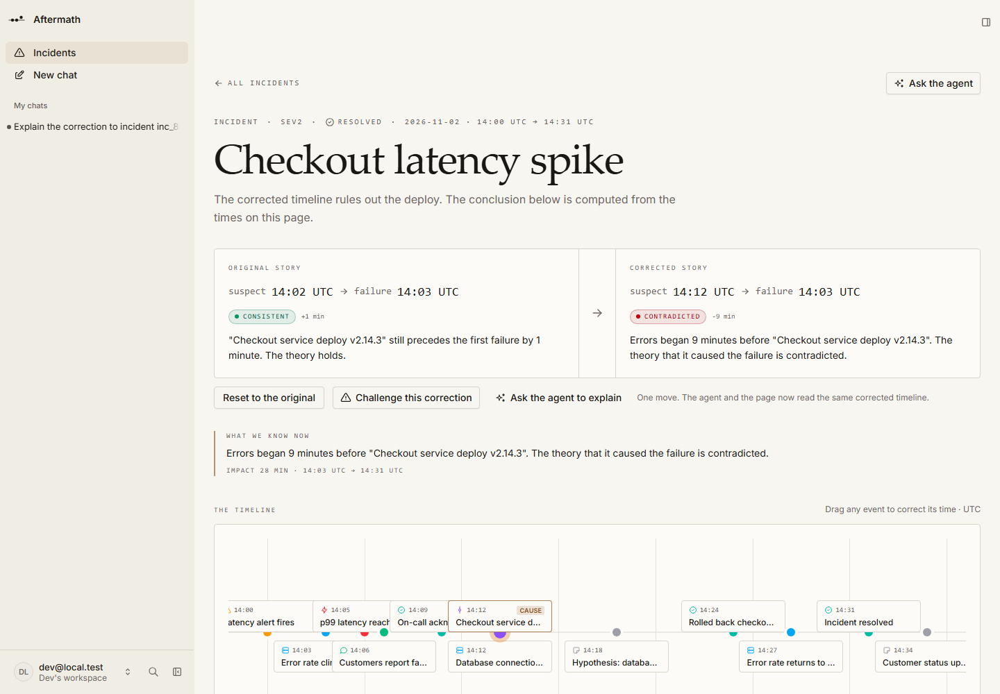
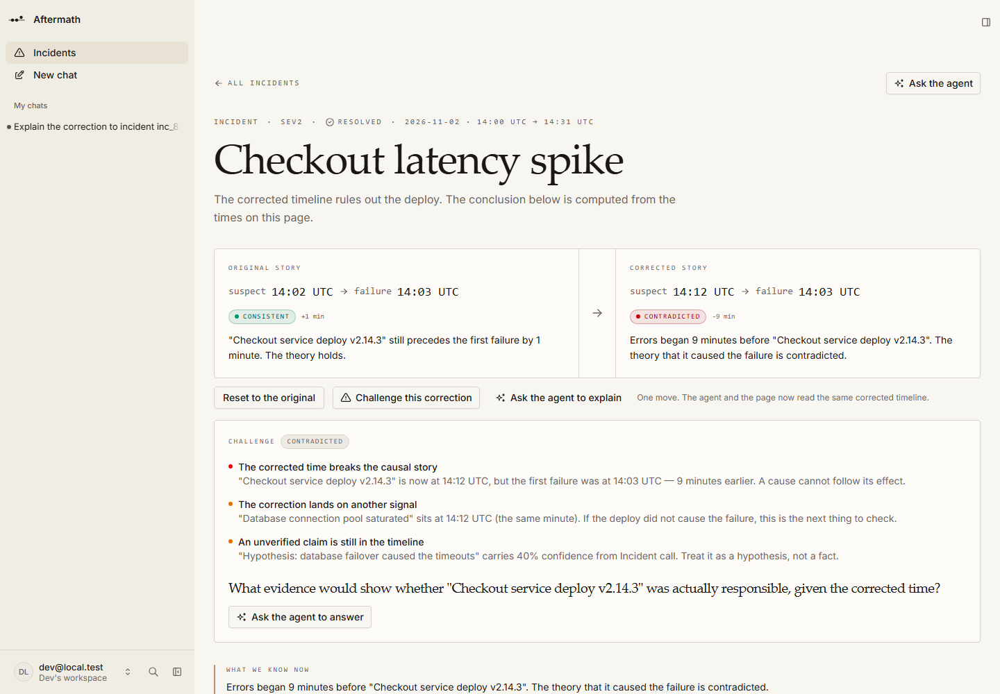
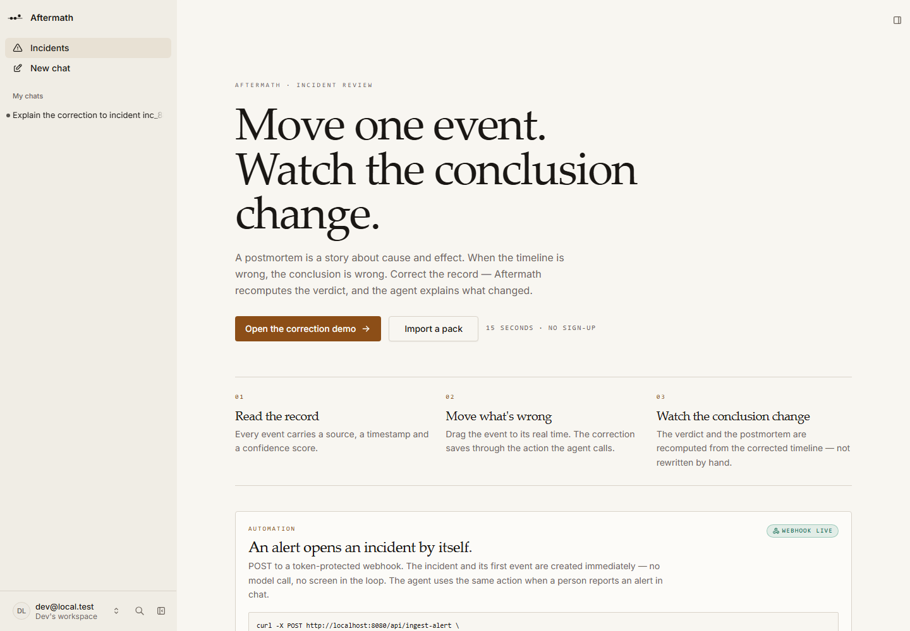

# Aftermath

**An incident postmortem where the timeline is editable and the conclusion is recomputed.**

Built for the [Agent-Native Hackathon](https://www.builder.io/hackathon) on Builder.io's open-source [Agent-Native](https://agent-native.com) framework.








---

## The problem

A postmortem is a story about cause and effect: *the deploy at 14:02 caused the errors at 14:03.* If the deploy actually happened at 14:12, that story is false — and every conclusion built on it is false too.

Timelines are usually wrong in small ways. Someone rebuilds them by hand from logs, deploys, alerts and chat, and the postmortem records whatever the room agreed on. Correcting the record later means rewriting the document by hand, and nobody does.

## The 90-second demo

1. **Read the original story.** The deploy sits at **14:02**, the first failure at **14:03**. Verdict: **consistent** — one minute apart, 28-minute impact window.
2. **Correct it.** One click (*Try the correction*) or a drag moves the deploy to **14:12**.
3. **Watch the conclusion change.** The verdict flips to **contradicted**: errors began **9 minutes before** the deploy, so the deploy cannot be the cause. The panel also notices that the corrected time now coincides with the database connection pool saturation at 14:12 — an alternative theory worth chasing.
4. **The postmortem updates itself.** The generated document includes a **correction log**:

   > “Checkout service deploy v2.14.3”: originally 14:02 UTC, corrected to 14:12 UTC.

That last line is the point. Most tools let you edit a timeline. Aftermath makes the correction part of the record, and recomputes what the record means.

## Bring your own incident

Open **Import a pack** (`/incidents/new`), paste what you actually have — alerts, deploys, log lines, chat, one event per line — or open a `.txt`, `.csv`, `.log` or `.md` file — and press **Build timeline**. Times and sources are kept exactly as written; lines without a time are skipped, not guessed. Or hand the same pack to the agent: it calls `create-incident-from-pack` and builds the same timeline through the same action.

```text
14:03 [error] 5xx rate climbs from 0.2% to 8.4% | Grafana
14:02 [deploy] checkout v2.14.3 to production | GitHub Actions #4821
14:12 [log] database connection pool saturated (100/100) | RDS metrics
```

Then challenge it. **Challenge this correction** runs `challenge-incident`: what the new time contradicts, which nearby signal now coincides, which claims are unverified, and the one question that would settle it. The agent can answer that question using the same timeline.

## Automation

The incidents page installs a **token-protected alert webhook**. POST an alert and the incident, plus its first event, are created immediately — no model call and no screen in the loop:

```bash
curl -X POST http://localhost:8080/api/ingest-alert \
  -H "content-type: application/json" \
  -H "x-aftermath-token: <token from Set up alert webhook>" \
  -d '{"title":"p95 latency above 2s","severity":"sev2"}'
```

The same operation is the `create-incident-from-alert` action, so the agent can call it when a person reports an alert in chat. A wrong token returns **401**; the alert source is kept as the incident's first timeline event.

## Share and export

- **Share** copies a public, read-only postmortem link (`/share/<token>`). The page renders without a session: same document, no app chrome.
- **Print** opens the browser's print dialog with a print stylesheet that strips the comparison, timeline, sidebars and buttons — leaving the postmortem for **Save as PDF**.
- **Slack** copies a formatted update with the verdict, the minute delta, the impact window, the corrections and the public link.
- **Discussion** comments are part of the incident and the generated document, so a decision recorded during the incident survives in the postmortem.
- **Search and filters** narrow the incident list by text, severity and status; the filter state lives in the URL, so it is shareable and visible to the agent.

## Why this is agent-native

- **One action, every surface.** `analyze-incident` is a typed function. The page calls it through a React hook, the agent calls it as a tool, and it is reachable over HTTP and the CLI. There is no second implementation of the verdict.
- **Original times are stored, not overwritten.** `incident_events.original_at` keeps the first version of every event, so “before” and “after” are both true data, not UI state.
- **The agent narrates; it does not invent.** The verdict, minute delta, impact window and nearest signal are computed. The model is instructed to explain them and never fabricate events, sources or confidence scores.
- **The agent builds the timeline too.** `create-incident-from-pack` and `add-incident-event` are actions, so the import screen and the agent create the same rows. Pasting a pack into chat is a supported path, not a demo trick.
- **It argues with you.** `challenge-incident` returns evidence-based objections and the question that would settle the dispute. The agent answers from the timeline, not from vibes.
- **Owner-only approval.** `approve-postmortem` is `uiOnly`: it works for a signed-in person in the app and is refused for the agent, MCP, raw HTTP and the CLI. Verified:

  ```
  $ pnpm action approve-postmortem --id inc_…
  Action "approve-postmortem" failed: This action can only be called from the signed-in app UI.
  ```
- **Shared application state.** The selected event is published to `selection` state, so “move this one” resolves without the user naming it.
- **Four-area parity.** Every feature has a UI, an action, written instructions (`AGENTS.md`) and application state.

## Actions

| Action | What it does |
| --- | --- |
| `list-incidents` | Incidents, newest first; optional text, severity and status filters |
| `get-incident` | One incident with its timeline (current and original times) and action items |
| `create-incident` | Create an incident |
| `create-incident-from-alert` | Create an incident from an alert; also powers the inbound webhook |
| `create-incident-from-pack` | Parse a pasted pack into a full timeline and store every event with its source |
| `add-incident-event` | Add one event, for lines found in a conversation |
| `update-incident-event` | Correct an event's time, title, detail, confidence or suspected-cause flag |
| `analyze-incident` | Deterministic verdict for the **current** or **original** timeline: consistent / weak / contradicted, impact window, nearest signal |
| `challenge-incident` | Evidence-based objections, the unverified claims, and the question that would settle it |
| `generate-postmortem` | The postmortem as Markdown, with a correction log and the discussion |
| `approve-postmortem` | Owner-only approval (UI capability required) |
| `create-postmortem-share` | Create or return the public read-only share token (hidden from the model) |
| `list-incident-comments` | Discussion comments, oldest first |
| `add-incident-comment` | Add a decision or a question to the incident |
| `update-incident-action-item` | Mark an action item open or done |
| `install-alert-webhook` | Return the alert webhook path and token (setup only; hidden from the model) |
| `delete-incident` | Remove an incident and its children (cleanup; hidden from the model) |
| `seed-demo-incident` | Load the demo incident (idempotent; hidden from the model) |

## Verified

| Check | Result |
| --- | --- |
| `pnpm typecheck` | clean |
| `pnpm agent-native:doctor` | clean, 14 guards |
| `pnpm test` | 3 parser tests pass |
| `pnpm verify:timeline` | **25/25 checks** against the running app over HTTP |
| Original timeline | `consistent`, +1 minute, 28-minute impact window |
| Deploy corrected +10 minutes | `contradicted`, 9 minutes before the failure |
| Original timeline after the correction | still `consistent` — the before state is preserved |
| Generated postmortem | includes the correction log with both times, and a CONTRADICTED summary |
| Challenge | 3 evidence-based objections and the settling question |
| Approval from HTTP/CLI | refused with **403**: “can only be called from the signed-in app UI” |
| Pack import | 3-line pack → 3 events, sources preserved, then cleaned up |
| Alert webhook | installs with a 32-char token; a wrong token returns **401**; a valid alert returns **202** and creates a sev1 incident with its source |
| Comments | added, listed and cleaned up over HTTP; included in the postmortem |
| Public share | creates `/share/<token>`; the page loads **without a session** (200, full document) |
| Filters | search + severity + status → 1 result; a nonsense search → 0 |
| Headless Chromium (end-to-end) | landing → search → demo → correction → contradicted → correction log → challenge → comment → share (clipboard + public page) → action toggle → reset → pack import → mark cause → contradicted → cleanup; no console errors, no failed requests, no horizontal overflow |
| Incident list and detail | HTTP 200 |

## Run it locally

Prerequisites: **Node.js 22.22+** and **pnpm**.

```bash
git clone https://github.com/obasky-dev/aftermath.git
cd aftermath
pnpm install
pnpm dev
```

Open **http://localhost:8080** and choose *Continue as local dev*.

Connect a model (Builder.io account, or an Anthropic / OpenAI key under *Custom keys*). The data screens and the computed verdict work without a model; the agent chat does not.

Load the demo incident from the empty state (**Load demo incident**) or, with the dev server stopped:

```bash
pnpm action seed-demo-incident
```

Then prove it:

```bash
pnpm test             # parser unit tests
pnpm verify:timeline  # 15 end-to-end checks against the running app
```

CI runs typecheck, the framework guards and the unit tests on every push (`.github/workflows/ci.yml`).

> PGlite locks its data directory to one process. Stop `pnpm dev` before running a CLI action, then start it again.

## Demo data

The seeded incident is fictional. Evidence links point at `example.com` and an illustrative GitHub Actions URL; no customer data is included. Timestamps are UTC so the server and client agree.

## Hackathon disclosure

Aftermath was built during the Agent-Native Hackathon, starting **2026-11-04**, from the official `chat` starter template. The incident schema, migrations, actions, before/after comparison, drag-to-correct timeline, deterministic verdict, postmortem generator and demo seed were written during the event. No pre-existing product code was reused.

Built with Agent-Native, React Router, Drizzle ORM, PGlite, Tailwind CSS and Tabler icons.
